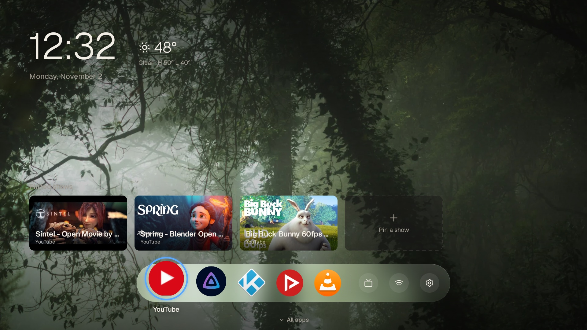
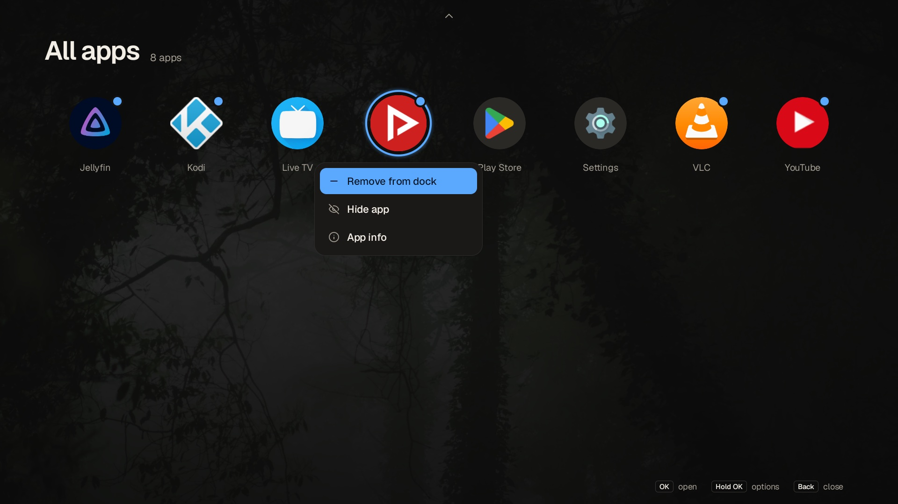
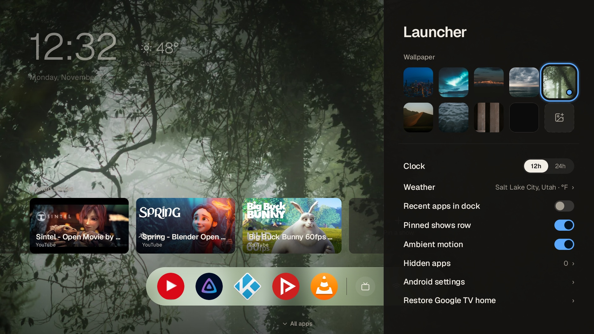
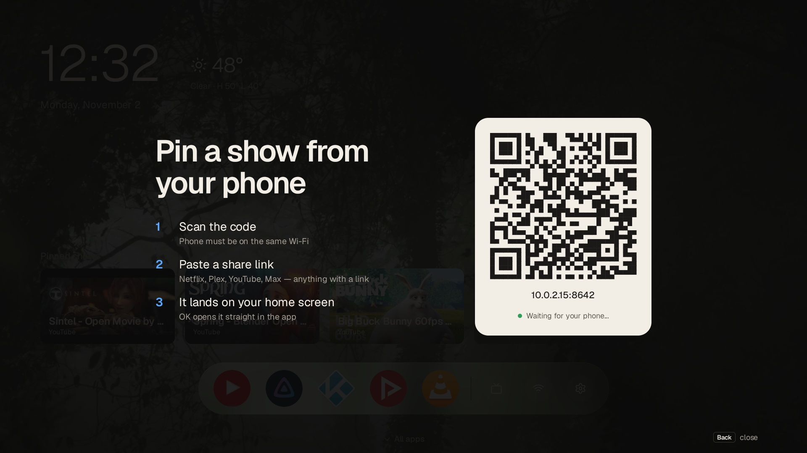

# Dash

A fast, minimal home screen for Google TV (built for the Google TV Streamer 4K).



| All apps + options | Settings | Pin from your phone |
|---|---|---|
|  |  |  |

- Kotlin + Jetpack Compose (foundation/ui only, no Material), single activity, ~2 MB release APK
- Glass dock with favorites, recent apps, and shortcuts; **↓ on the dock** slides up All apps
- Pinned shows (deep links), wallpaper, and weather ZIP are sent **from your phone** by scanning a QR code;
  the TV runs a LAN-only server just while that screen is open, and requests need the QR's one-time token
- Weather from [Open-Meteo](https://open-meteo.com) (no key); only the looked-up location is sent

Designs: `design/mockup.html` (open in a browser; arrow keys work) and `design/screens/*.png` (Pencil exports).

Docs: [`docs/STATUS.md`](docs/STATUS.md) (progress, untested items, next steps) ·
[`docs/DECISIONS.md`](docs/DECISIONS.md) · [`docs/DEVICE.md`](docs/DEVICE.md) (what was changed on the TV, undo) ·
[`CLAUDE.md`](CLAUDE.md) (architecture and dev notes). One-step install: `tools/deploy.sh` (or `tools/deploy.sh emulator`).

## Build

Use Android Studio's bundled JDK (system Java may be too new for Gradle):

```sh
export JAVA_HOME="/Applications/Android Studio.app/Contents/jbr/Contents/Home"
./gradlew :app:assembleRelease     # app/build/outputs/apk/release/app-release.apk
```

Release builds are R8-minified and signed with the debug key (sideload only).

## Install on the Streamer

On the TV: **Settings → System → About**, press **Android TV OS build** 7×, then
**Developer options → Wireless debugging → Pair device with pairing code**.

```sh
adb pair <ip>:<pair-port> <code>
adb connect <ip>:<port>
adb install -r app/build/outputs/apk/release/app-release.apk

# One-time: allow the Recents section to read app usage
adb shell appops set dev.jolley.dash GET_USAGE_STATS allow
```

### Make it the Home screen

Google TV has no setting for this, so the stock launcher is disabled (fully reversible):

```sh
adb shell pm disable-user --user 0 com.google.android.apps.tv.launcherx
# The setup-recovery screen is next in line for Home (priority 1), so it goes too.
# Disabling it dropped Wi-Fi once on the Streamer; reconnecting fixed it.
adb shell pm disable-user --user 0 com.google.android.tungsten.setupwraith
# Breaks the tie with any other installed launcher.
adb shell cmd package set-home-activity dev.jolley.dash/.MainActivity
```

`set-home-activity` alone isn't enough: Google's launcher declares a higher Home priority than any app.

### Undo

```sh
adb shell pm enable com.google.android.apps.tv.launcherx
adb shell pm enable com.google.android.tungsten.setupwraith
```

## Remote controls

| Where | Key | Does |
|---|---|---|
| Dock / shows | ← → ↑ | Move focus |
| Dock | ↓ | Open All apps |
| All apps | ↑ on top row, Back | Close |
| Anything | Hold OK (or Menu) | Options: move, add/remove from dock, hide, app info |
| Dock gear | OK | Launcher settings (wallpaper, clock, weather, toggles, hidden apps) |

## Credits

Geist font © The Geist Project Authors (SIL OFL 1.1). Icons from Lucide (ISC).
